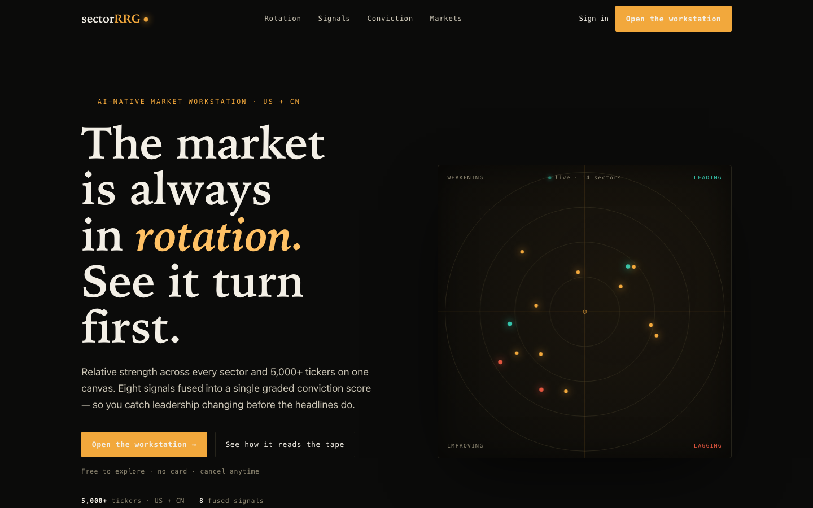
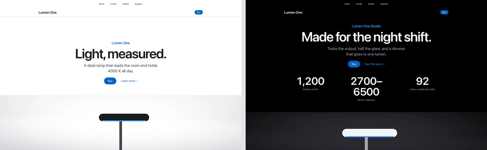

# fantastic-ui

**An agent skill for Codex and Claude Code that combines instrument-grade visual design with understandable interactions — from landing pages to app pages, dashboards, panels, and subpanels.**

<p align="center">
  
</p>

<p align="center"><em>Built with this skill: zero webfonts, zero UI libraries, one accent color, and a hero that is the product actually running on a &lt;canvas&gt;.</em></p>

---

## Why this exists

Ask an AI for a landing page and you usually get the same page everyone gets: centered headline, gradient blob, three feature cards with icons, `#6366f1`. It looks like a template because it *is* one — the statistical average of every landing page ever shipped.

This skill was distilled from a real redesign that went the other way: a marketing page for a quantitative finance terminal that feels like **holding the instrument**. The methodology generalizes to any product with real data or real behavior to show — dev tools, analytics, infra, fintech, monitoring.

It's not a component library and not a theme. It's the **decision discipline**, with working code for the hard parts.

## Usability and visual-reference analysis

The updated skill treats visual quality, interaction quality, and accessibility as one system. It bundles the interaction references directly, so these workflows do not require separate design-foundation or heuristic skills.

- **Norman's interaction foundations:** affordances, signifiers, natural mapping, constraints, feedback, conceptual models, and recovery from human error. Trace a task through the seven stages of action to locate a gulf of execution or evaluation.
- **Krug's usability rules:** make the purpose and primary action self-evident, support scanning and recognition, and use the Trunk Test to check whether users can orient themselves.
- **Nielsen heuristic audits:** inspect the states a task actually traverses, report severity **0–4**, propose a fix, and name how it will be verified. Major task failures, keyboard blockers, inaccessible controls, and dark patterns block shipping.
- **Two separate audit scores:** an interaction-foundation score and a heuristic-readiness score, each **0–10**, with evidence and failed rows. They are diagnostic summaries, not substitutes for observing users or proof of accessibility compliance.
- **Reference-driven design:** analyze composition, hierarchy, typography geometry, color roles, and responsive constraints. Keep **Observed**, **Inferred**, and **Proposed adaptation** separate; a screenshot does not reveal its exact font, prompt, hidden settings, or working behavior.
- **Implementation that preserves the product:** translate references into existing tokens, native text, shared components, and explicit constraints. Keep the chosen direction, meaningful interactions, performance budget, and accessibility gates intact.

Choose the smallest workflow that fits:

| Request | Starting point | Expected output |
| --- | --- | --- |
| Build or redesign a surface | Existing token system or preset check, then a one-sentence brief | Implemented surface and verified states |
| Review usability | Critical tasks and heuristic audit | Severity-ranked findings, separate scores, fixes and verification methods |
| Explain why a flow is confusing | Seven stages of action and the two gulfs | Evidence of where the task breaks and a targeted correction |
| Review navigation or forms | Trunk Test, scanning rules, and Nielsen checks | Orientation, labels, feedback, recovery, and input recommendations |
| Work from screenshots or a mood reference | Visual-reference analysis | Observations, labeled inferences, and a concrete implementation brief |

Explore the bundled [design foundations](skills/fantastic-ui/references/design-everyday-things/), [usability heuristics](skills/fantastic-ui/references/ux-heuristics/), and [visual-reference analysis](skills/fantastic-ui/references/visual-reference-analysis.md).

## The five disciplines

1. **Single-accent color system** — one accent, ground/hairline/ink scales tinted toward it, and semantic colors (up-teal, down-red) that *only ever* appear with their meaning. Color is information, not decoration.
2. **Three-face typography, zero webfonts** — humanist serif display + monospace data face + system sans body, all system stacks. The serif/mono contrast does the work webfonts get hired for, at zero performance cost.
3. **Live proof over screenshots** — the hero is the product running on a `<canvas>`: DPR-aware, pauses when the tab hides, renders one static frame under `prefers-reduced-motion`, cleans up completely.
4. **Page rhythm** — alternating texture bands: stat tape, thesis explainer, asymmetric bento with painted sparklines, an atmosphere band over a token-generated plate (≤30 KB WebP), an interactive ARIA-correct toggle, honest fine print.
5. **Performance and accessibility as gates, not polish** — a pass/fail ship checklist: reduced-motion paths for every animation, skip link, designed focus rings, no horizontal overflow at 320px, RAF verified stopped when the tab hides.

## Imagery, generated from the tokens

Every page gets an imagery decision, announced with the brief: *"Imagery: warp plate behind the page header, inherited by every panel's empty states (gen_atmosphere, seed 7)"*, or `none` with a stated reason. In a product, each route has one plate, and every panel and subpanel inherits it in its empty and first-run states through the shared empty-state primitive; populated panels never carry imagery. The default is a **plate** rendered by `scripts/gen_atmosphere.py` from the page's own palette tokens: local, keyless, deterministic and ≤30 KB WebP. Zero-byte SVG texture comes next. AI imagery is used only for photographic slots a preset needs, and it falls back to a plate when no provider is available. Plates are atmosphere only. They never show UI, text, people, logos or fake data, and they never sit behind data (the one carve-out is big-type marketing stats, under the scrim and after the real-pixel gate). They are static and `aria-hidden`, they sit in a named slot (a banded token `color-mix()` scrim plus a fit: `header-band`, `state-band`, `center-band`, `phone-strip`), and both directions are measured on the composited page: text over a plate keeps its contrast, and the plate stays visible (≥8% of the covered pixels ≥1.1:1 and ≥1% ≥1.3:1 against the page). Every imagery claim cites those numbers. The tools exist because plates once shipped at 0.1–0.4% visible while passing every text check:

- `gen_atmosphere.py plate --page --slot --scrim --seeds 1-8 --pick best` renders for the slot the plate will sit in, refuses a base that is not the page (`page_mismatch`) and a result too faint for that slot (exit 4).
- `gen_atmosphere.py score` scores any WebP on a named slot offline; `batch --manifest` renders, scores and swaps a project's plates atomically, and re-rolls AI images only with `--reroll-ai`.
- `scripts/plate-check.js` measures every plate host on the live page, with a stale-CSS sentinel so an unloaded edit is never reported as a measurement.
- `templates/tests/` holds consumer tests to copy into the project; `evals/plate-visibility/` is a fixture app that proves the tools catch the failures.

Procedure: [ai-atmosphere.md](skills/fantastic-ui/references/ai-atmosphere.md); slots: [plate-slots.md](skills/fantastic-ui/references/plate-slots.md); AI prompts: [ai-motifs.md](skills/fantastic-ui/references/ai-motifs.md).

## The mechanics layer

The five disciplines decide **direction**. They don't, on their own, stop a surface from looking amateur — a correct palette laid out with ad-hoc spacing and one global `line-height` still reads as assembled. The mechanics layer is where most "I can't say why this looks off" problems actually live:

- **Hierarchy runs on color first, weight second, size last.** Most clutter is fixed by demoting something to `--muted`, not by enlarging what you want seen. To emphasise, de-emphasise everything around it.
- **A spacing scale you actually obey**, and the ambiguous-spacing bug — a label equidistant from the field above and below — which breaks more forms than any amount of restyling.
- **Line-height proportional to length and size**, never one global value; prose capped at 45–75 characters.
- **HSL scale construction from three anchors**, with saturation *raised* at both extremes (or your tinted greys drift back to neutral) and **hue rotation** as a second brightness dial — toward 60/180/300 to lighten, 0/120/240 to darken, capped at 20–30°.
- **Depth on a dark ground is lightness + hairline, not shadow** — shadows have nothing to block against near-black. This is the mechanism behind discipline 1's "hairlines, not shadows", and the reason a raised dark surface usually needs both cues: adjacent ramp steps are often under 1.3:1.
- **Empty states are a designed surface**, with *empty*, *filtered to nothing* and *failed to load* kept as three distinct states.
- **The AI-default checklist** — purple gradients, uniform max radius, three identical cards, blanket shadows, default indigo, hero→features→testimonials on a product that isn't a landing page. Plus the gut check: *would a developer guess this was generated?*

This layer is adapted from [*Refactoring UI*](https://www.refactoringui.com/) by Adam Wathan & Steve Schoger. Several of the book's defaults **invert** on a dark ground, and those are marked `↯` in the reference rather than copied across. Where the mechanics and the disciplines disagree, the disciplines win: they are the direction, the mechanics are the mechanism.

## Twelve theme presets, with automatic selection

The five disciplines say *how* to design; a preset is a pre-committed answer to *what direction*. The skill ships twelve contrast-validated directions — from Coastal Editorial and Blueprint Mono to Midnight Showroom, Dispatch Yellow and Gallery White (product-gallery minimalism with studio-lit products) — each with a full token block, type pairing, and component grammar.

Selection is part of the workflow, not a menu you're shown: before writing a brief, the skill runs a preset check with three gates — the user named a direction → use it; the codebase already has a token system → **no preset** (recover and extend the existing brief instead of running a second design system); otherwise score the request against a signal table (medium, domain, imagery, density) with per-preset disqualifiers, and render the strongest two or three directions as sample pages to pick from (next section).

### See the directions before anything is built

When the look is not decided (no DESIGN.md, no existing design system, no look named), the skill does not describe options in words. It scores the request against the presets, picks the two or three strongest directions (often including a fresh one), and renders each as a small sample page using **your** product name, headline and numbers. A side-by-side sheet shows them at desktop and phone width, marks one as recommended with the reason, and the full build starts only after you pick. `scripts/direction-samples.mjs` builds the pages, screenshots and sheet from a short manifest, and flags any colour pair under 4.5:1; `scripts/check-samples.mjs` then holds every sample to the same gates as a shipped page (WCAG 2.2 AA via axe, reflow 320–1440, targets, focus, no-JS, the preset's own gates, lint), and nothing is shown until all pass. Procedure: [direction-samples.md](skills/fantastic-ui/references/direction-samples.md).

### Your DESIGN.md comes first

If the project has a [DESIGN.md](https://github.com/google-labs-code/design.md) (Google Labs' open format for describing a design system to coding agents), the skill reads it before considering any preset. It treats the file as the recorded direction and announces it in one line. Three rules govern it:

- **Mismatches are always asked about.** `scripts/design_md.py drift` compares the file's tokens with the stylesheet's custom properties. Every difference, missing token or likely rename is put to you as a question, every time; the skill never decides which side is right.
- **Replacing needs an explicit request.** Naming a preset in a project with a DESIGN.md gets you a question ("follow the file, or replace it?"), not a rewrite. Asked to replace it, the skill writes the new file beside the old one, shows the diff, and moves it into place only on a yes. Then it migrates the code, tokens first.
- **No file? It offers to write one** once the direction is settled. `design_md.py export --preset L` turns any of the twelve presets into a DESIGN.md. All twelve pass the official linter (`@google/design.md` 0.4.0) with 0 errors and 0 warnings.

Procedure: [design-md.md](skills/fantastic-ui/references/design-md.md).

### Example: Gallery White

<p align="center">
  
</p>

Ask for the preset by name:

> *"/fantastic-ui build a one-page launch site for our desk lamp in Gallery White"*

The skill announces the choice in one line before writing code, so you can redirect it. Then it builds the page from [gallery-modules.md](skills/fantastic-ui/references/gallery-modules.md):

- white bands with one black stage
- a glass nav that turns dark over the stage
- display type, pill buttons and 28 px tiles
- studio light behind the product, generated with `gen_atmosphere.py plate --style studio`

Finally it runs `verify-preset.mjs --preset L`. That check fails a page with shadows or borders on tiles, a nav below 80% opacity, a weakened accent, or studio light behind text.

The page above is in [examples/gallery-white](examples/gallery-white/), with the commands that made its plates and the measured results. A described look ("Apple-style", "white gallery, product on studio light") usually selects the same preset. An existing design system takes precedence unless you ask to replace it.

## The exam: nothing is done until it passes

Every page the skill builds or changes, in any project, has to pass `scripts/exam.mjs` before the work is called done. A failing page is fixed and examined again, never shipped with a note, and the closing message reports the pass count (`exam: 3/3 pass`).

| Check | What fails it |
| --- | --- |
| axe-core, WCAG 2.0/2.1/2.2 A + AA, at 1440 and 390 px | any violation; `incomplete` nodes are listed for measuring by hand, never passed |
| Reflow at 320, 375, 390, 768, 1024 and 1440 px | horizontal overflow, or content cut off under `overflow-x: clip` |
| Targets and labels | a link or button under 24×24 px; a button label that wraps |
| Keyboard and structure | no skip link first, a missing `header`/`nav`/`main`/`footer`, not exactly one `h1`, no `lang`, a focus ring under 2 px or 3:1 |
| No-JS pass | text a visitor sees with JavaScript is in the page but hidden without it |
| `--dialog <trigger>`, at 1440 and 390 | the trigger opens no dialog from the keyboard; the dialog has no name, is not modal, lacks a close button, lets Tab out, fails axe while open, ignores Escape or loses focus on close |
| `--preset <A–L>` | any of that preset's gates in `verify-preset.mjs` (contrast, zero webfonts, asset weight, reduced motion, token roles, accent restraint, separation, its own traps) |
| `--lint <path>` | any `lint-surface.mjs --strict` finding in the touched source |

The exam needs `playwright` and `@axe-core/playwright`, installed in the project or pointed to with `--modules <node_modules>`. Without them the work is reported as **not examined**, not as done.

### Examples

A landing page and its pricing page on the dev server, built in Preset E, with the source that changed:

```bash
node ~/.claude/skills/fantastic-ui/scripts/exam.mjs \
  --url http://localhost:3000/ --url http://localhost:3000/pricing \
  --preset E --lint src/app/landing
```

A page that opens overlays. Pass each trigger's selector; a selector found on none of the pages fails:

```bash
node ~/.claude/skills/fantastic-ui/scripts/exam.mjs \
  --url http://localhost:3000/settings \
  --dialog "#delete-account" --dialog "[data-open=shortcuts]"
```

A static folder (a built site, direction samples, a component preview). The exam serves the folder itself and examines every `.html` page in it; `--fragment` drops the page-only checks (skip link, landmarks, one `h1`) for a component preview:

```bash
node ~/.claude/skills/fantastic-ui/scripts/exam.mjs dist/
node ~/.claude/skills/fantastic-ui/scripts/exam.mjs previews/button --fragment
node ~/.claude/skills/fantastic-ui/scripts/exam.mjs dist/ --json exam.json   # results for CI
```

Exit codes: `0` every page passes, `1` something failed, `2` bad input.

### What a failure looks like

`scripts/fixtures/exam/traps/` reproduces two traps catalog components often ship: an intro line held at `opacity: 0` until a script fades it in, and a help panel that is a `div` with `role="dialog"` and nothing else. The real output:

```text
$ node exam.mjs fixtures/exam/traps --dialog "#open-help"
FAIL  index.html
    dialog "#open-help" at 1440: dialog has no accessible name (aria-labelledby its heading, or aria-label)
    dialog "#open-help" at 1440: dialog is not modal (showModal(), or aria-modal="true" with a focus trap)
    dialog "#open-help" at 1440: no visible close button inside the dialog
    dialog "#open-help" at 1440: focus did not move into the dialog
    dialog "#open-help" at 1440: Tab and Shift+Tab moved focus out of the open dialog
    dialog "#open-help" at 1440: Escape did not close the dialog
    hidden without JavaScript (1): <p> "Electric bikes by the day, collected at the ferry."; hide it in CSS only behind a class the script adds

exam: 0/1 pass · NOT DONE until every page passes
```

(The same six dialog lines repeat at 390 px; they are left out here.) The passing twin, `fixtures/exam/good/`, shows both fixes: a native `<dialog>` opened with `showModal()`, named by its heading, with a Close button and focus returned to the trigger; and the fade gated in CSS behind a class the script adds, so without JavaScript the line is simply there:

```html
<script>document.documentElement.classList.add("js");</script>
<style>
  html.js .reveal { opacity: 0; transition: opacity 0.4s; }
  html.js .reveal.in { opacity: 1; }
</style>
```

```text
$ node exam.mjs fixtures/exam/good --dialog "#open-booking"
PASS  index.html

exam: 1/1 pass
```

### Example: adopting a component from a library

> *"/fantastic-ui add the responsive modal from that UI catalog to our settings page"*

Before anything is copied, the skill follows [third-party-components.md](skills/fantastic-ui/references/third-party-components.md):

1. **Rules fit.** The component is refused if it needs WebGL, GSAP, a webfont or a second accent, and a native `<dialog>` is offered instead when it does the same job.
2. **Licence file.** It reads the licence file at the revision being copied, not the README badge, and says what it allows (use in this product, or redistribution in a kit).
3. **Source over registry.** It lists the real imports, maps them to the project's own helpers, and replaces hard-coded colours, fonts and radii with tokens.
4. **Installer writes.** If an `npx … add` command is involved, it shows the pinned version and every file it would write (global CSS included) and asks before running it.
5. **Exam.** The adopted modal is examined like the project's own code: `exam.mjs --url http://localhost:3000/settings --dialog "#open-modal"`.

## Beyond the landing page: product surfaces

The same five disciplines apply *inside* the product. The skill includes a dedicated workflow for modifying existing app pages, panels, and subpanels:

- **App-level brief and tokens** — one one-sentence direction and one token block on the app shell; page-local colors are forbidden, so every screen draws from the same ground scale and single accent.
- **A six-step retrofit procedure** — audit (inventory + color-literal grep baseline) → brief → mechanical tokens-first commit → shared primitives → screen-by-screen migration (one PR each, highest-traffic first) → a cross-screen consistency gate.
- **Panel anatomy and nesting rules** — a uniform panel skeleton (mono eyebrow head, hairline separation, actions right), depth encoded by ground-scale steps instead of shadows, maximum three nesting levels.
- **States as first-class design** — skeleton loading on the ground scale, honest empty states, error red confined to actual errors, stale-data timestamps.
- **Back-office or workbench** — one question decides density and character: does the surface revolve around a batch of business objects, or one thing the user does over and over?
- **Agent consoles** — a run stream instead of a chart, nine run states each with its required action, a stop control that never leaves the screen, approval cards inside the stream, and cost as a one-line receipt ([agent-console.md](skills/fantastic-ui/references/agent-console.md)).
- **Workflows, components, charts, phones** — wizards, settings, review queues and checkout ([workflow-surfaces.md](skills/fantastic-ui/references/workflow-surfaces.md)); a one-component route with eight states and a preview file ([component-states.md](skills/fantastic-ui/references/component-states.md)); charts picked by the question with accessibility grades and a chart-only colour ramp ([data-charts.md](skills/fantastic-ui/references/data-charts.md)); phone-only screens with safe areas, thumb zone and native furniture ([phone-surfaces.md](skills/fantastic-ui/references/phone-surfaces.md)).
- **Motion by the cheapest route** — CSS, native scroll-driven animation, View Transitions and WAAPI before canvas; no GSAP or WebGL; content survives with JavaScript off ([motion-routes.md](skills/fantastic-ui/references/motion-routes.md)).
- **Adopting someone else's component** — a catalog block, registry `add` or effect kit is checked against the skill's rules, its licence file (not the badge), its real source and its installer's writes before it goes in, then examined like your own code ([third-party-components.md](skills/fantastic-ui/references/third-party-components.md)).
- **A static lint pass** — `scripts/lint-surface.mjs` catches dead local references, the `overflow-x: hidden` that silently kills a sticky nav, blocked zoom, missing reduced motion, opacity-dimmed text, colour literals outside tokens, AI-default palettes and copy tells, and prints what it cannot judge.

## Whole-app recursive polish

When the scope is *every* surface — "polish every page, don't miss anything" — a per-screen procedure isn't enough. The skill includes a sweep mode that adds coverage mechanics on top of the retrofit workflow:

- **Inventory by recursive traversal** — walk every route's import tree from the code (modals, drawers, toasts, and command palettes included), deduplicating shared components into single work items; never trust a route-count estimate.
- **Prior-art reconciliation** — detect an existing token system, recover its brief instead of writing a competing one, and extend any existing style-guard tests rather than creating parallel ones. Dual-theme apps get one token vocabulary with light/dark values per token, contrast-validated in both.
- **Shared-primitives-first ordering**, then routes by traffic, with a stated fallback ranking when no analytics exist.
- **Batched migration** — 3–5 surfaces per batch (the batch is the PR unit in sweep mode), a presentation-only diff gate, per-batch a11y pass, and a persistent ledger file that survives session boundaries.
- **Loop-until-dry completion** — the job is done only when a *fresh* re-inventory finds zero unpolished surfaces and the mechanical proofs pass (zero color literals outside the token file, zero axe-core critical/serious). Early stops are recorded as explicitly deferred, never silently dropped.

## The accessibility phase

Accessibility isn't a checklist item here — it's a required **check-and-fix phase** targeting WCAG 2.2 AA, run at three moments:

1. **Token time** — a runnable contrast-matrix script validates every ink×ground and accent×ground pair once (4.5:1 text, 3:1 UI/focus), so every screen inherits compliance; failing pairs are fixed in the token, never locally.
2. **Build time** — landmarks, heading order, real ARIA, canvas/marquee text alternatives built in as you go.
3. **Pre-ship** — automated sweep (axe-core with `wcag22aa` tags + Lighthouse) plus four manual passes (keyboard, screen reader, reduced motion, 320 px / 200 % reflow), a severity triage where critical/serious findings block the ship, then fix and **re-audit to zero blockers**.

The reference includes fix patterns keyed to the design system (two-layer focus rings, semantic-color text variants, ≥24 px target sizes, `aria-live` on refreshing panels) and covers the new WCAG 2.2 criteria most audits miss.

The phase is hardened with lessons from real audits, where the tooling itself was the problem as often as the UI:

- **Never dim text with `opacity-*`** — it survives code review (every class references an approved token), fails contrast anyway, *compounds* through nesting (0.60 × 0.70 = 0.42 alpha → a measured 1.83:1), and creates a stacking context that blinds axe. Semantic tint backgrounds count as grounds in the contrast matrix too.
- **axe `incomplete` ≠ `violations`** — the DevTools extension paints both with the same red SERIOUS card. `incomplete` means "could not compute": each node gets measured by hand and recorded, because on one audit 0 violations + 14 incomplete concealed 9 genuine AA failures — and because chasing "incomplete = 0" makes you restyle compliant UI.
- **Validate the measuring instrument** — four documented bugs that make a hand-rolled contrast checker lie (oklab parsed as RGB, premultiplied-alpha precision loss, ignored gradients, walking past opaque layers), and a two-backdrop resolution technique that sidesteps all of them.
- **Audit the surface that actually renders** — not an error/empty shell, not a file the route never mounts, not dead code; every designed state (loading, empty, error, locked, approved) is a coverage item.
- **Never fake structure** — a column-major DOM gets self-describing cells, not a `role="grid"` that announces wrong coordinates; a dimming that *encodes state* gets a replacement channel before removal, then a re-measure (which is how a pre-existing failure hiding under one was found).
- **Guard every fixed bug class with a mutation-tested regression test** — a guard that has never gone red has never been shown to work.

## Install

The commands below are for a fresh installation. If you already have a `fantastic-ui` skill, preserve local edits before replacing it. Install the complete skill directory, including `references/`, `scripts/` and `templates/`, not just `SKILL.md`.

Clone the repository:

```bash
git clone https://github.com/succtorlin/fantastic-ui.git
```

**Codex** (global skill directory used by this package):

```bash
mkdir -p ~/.codex/skills
cp -R fantastic-ui/skills/fantastic-ui ~/.codex/skills/
```

**Claude Code:**

```bash
mkdir -p ~/.claude/skills
cp -R fantastic-ui/skills/fantastic-ui ~/.claude/skills/
```

Or, if you use the `skills` CLI:

```bash
npx skills add succtorlin/fantastic-ui
```

For a project-local Claude Code installation, copy into `<repo>/.claude/skills/` instead. After installation, start a new session if your client has already loaded its skill list.

## Use

Once installed and available in your client's skill list, ask for things like:

- *"Build a landing page for my API monitoring tool"*
- *"Redesign our homepage, it looks like a template"*
- *"Make this page feel premium"*
- *"Restyle the dashboard panels to match the landing page"*
- *"Apply the same style across all the app's pages and subpanels"*
- *"Polish every single surface of the app — make sure nothing is missed"*
- *"Run a WCAG audit on this page and fix what fails"*
- *"Add a settings drawer, and make sure it passes the exam with the dialog check"*
- *"We want this hero effect from a component library. Is it allowed, and how do we adopt it safely?"*
- *"Make the app accessible / fix the contrast and keyboard issues"*
- *"Build the site in the Marigold Report style"* (or any preset — or let the skill pick one)
- *"Build a launch page for our desk lamp in Gallery White"* (see the [example](examples/gallery-white/))
- *"Follow our DESIGN.md and check the CSS still matches it"*
- *"Replace our DESIGN.md with Gallery White and migrate the app"*
- *"Students cannot find the next step in this onboarding flow. Diagnose it and propose a fix."*
- *"Audit this dashboard using Norman, Krug, and Nielsen; show evidence, severity, and separate scores."*
- *"Use these screenshots to define the typography, composition, and responsive rules without replacing our existing design system."*

Invoke it explicitly with `$fantastic-ui` in Codex or `/fantastic-ui` in Claude Code. State whether you want analysis only or implementation; asking for an audit does not by itself request code changes.

**Want to see how a session actually goes?** [docs/USE-CASES.md](docs/USE-CASES.md) walks through six scenarios end to end — what to say, what the skill does, what it asks you, and what you get.

## What's inside

```
skills/fantastic-ui/
├── SKILL.md                        # the methodology + ship checklist
├── scripts/
│   ├── verify-preset.mjs            # runnable checks against a live page (+ advisory imagery count)
│   ├── direction-samples.mjs       # 2–3 candidate looks as sample pages + side-by-side sheet
│   ├── exam.mjs                    # THE exam every page must pass: axe WCAG 2.2 AA, reflow, targets,
│   │                               #   focus, landmarks, preset gates, lint, no-JS pass, --dialog
│   ├── exam.test.mjs               # browser tests for the no-JS pass and the dialog check
│   ├── fixtures/exam/              # a page that passes the exam and its trap twin (hidden text, fake dialog)
│   ├── direction-samples.test.mjs  # generator tests (no browser)
│   ├── check-samples.mjs           # the exam over a sample folder + the sheet's gate lines
│   ├── lint-surface.mjs            # static lint: dead refs, sticky-killing overflow, zoom, reduced motion,
│   │                               #   text opacity, literals outside tokens, AI defaults, copy tells
│   ├── lint-surface.test.mjs       # mutation tests, one per rule
│   ├── preset-gates.json           # universal and per-preset gate declarations
│   ├── gen_atmosphere.py           # token plates, SVG texture, AI wrapper, compressor, slot scoring
│   │                               #   (`score`), manifest builds (`batch`) — ≤30 KB, with a ledger
│   ├── design_md.py                # DESIGN.md: find, read, drift vs the CSS, export a preset
│   ├── test_design_md.py           # its tests (no network)
│   ├── plate-check.js              # browser check: plate visibility + text over it, stale-CSS sentinel
│   ├── plate-check.test.mjs        # `node --test` unit tests for its pure helpers
│   └── plate-check-shot.mjs        # optional Playwright screenshot variant
├── templates/tests/                # consumer tests to copy: plate visibility, banded scrims in the CSS
├── templates/direction-sample/     # the shared token-driven stylesheet for direction samples
├── evals/plate-visibility/         # fixture app, manifest and offline run for the imagery tools
└── references/
    ├── visual-reference-analysis.md # composition, typography geometry, observation vs. inference,
    │                               #   reusable briefs and responsive native UI translation
    ├── design-everyday-things/     # ten references: Norman's foundations, action stages,
    │                               #   execution/evaluation gulfs, human error and case studies
    ├── ux-heuristics/              # seven references: Krug, Nielsen, audit template,
    │                               #   conflicts, cultural UX, dark patterns and accessibility
    ├── css-architecture.md         # full token system, scoped CSS-module rules, shared primitives
    ├── canvas-hero.md              # annotated live-canvas hero, sparklines, scroll reveals —
    │                               #   with the complete lifecycle contract (DPR / visibility / reduced-motion / cleanup)
    ├── ai-atmosphere.md            # imagery procedure: slots per surface, plate → svg → ai → compress,
    │                               #   score + batch, markup contract, text + visibility gates
    ├── plate-slots.md              # named scrim + fit slots with exact CSS, score calls, measured ranges
    ├── ai-motifs.md                # domain → motif table, five-part AI prompt, consent and cost
    ├── product-surfaces.md         # retrofit procedure for app pages/panels/subpanels: audit → tokens →
    │                               #   primitives → migration, panel anatomy, nesting depth, state design,
    │                               #   back-office vs workbench
    ├── direction-samples.md        # open direction → render 2–3 samples, recommend, build after the pick
    ├── agent-console.md            # run stream, nine run states, stop control, approval cards, cost receipt
    ├── workflow-surfaces.md        # one page or steps, field kit, pre-submit check, commit, review queues,
    │                               #   commerce flows
    ├── component-states.md         # one-component route: eight states, geometry, preview file
    ├── third-party-components.md   # adopting a catalog/registry component: rules fit, licence file,
    │                               #   source over registry, installer writes, traps the exam catches
    ├── data-charts.md              # chart by question, accessibility grades, bars, chart colour under one accent
    ├── motion-routes.md            # route ladder, effect lookup, beat sheet, motion slop
    ├── phone-surfaces.md           # phone frame, safe areas, thumb zone, touch, native furniture
    ├── theme-presets.md            # twelve named directions with contrast-validated token blocks and
    │                               #   component grammar, plus the signal table and gates for automatic
    │                               #   preset selection (and refusal)
    ├── design-md.md                # a project's DESIGN.md: precedence, drift questions,
    │                               #   create on a yes, replace only on an explicit request
    ├── gallery-modules.md          # Preset L kit: tone bands, glass nav + chapter strip, studio-lit
    │                               #   product stage, bento tiles, spec numerals, gates
    ├── wcag-audit.md               # WCAG 2.2 AA check-and-fix phase: contrast-matrix script (semantic
    │                               #   tints included), the opacity rule, axe sweep with violations-vs-
    │                               #   incomplete triage, validating your own checker, auditing the real
    │                               #   rendered surface, four manual passes, on-system fix patterns,
    │                               #   mutation-tested guards, re-audit loop
    ├── ui-mechanics.md             # the mechanics layer: hierarchy dials, spacing scale + ambiguous
    │                               #   spacing, type scale and line-length coupling, HSL construction
    │                               #   (saturation at the extremes, hue-rotation brightness, contrast
    │                               #   escape hatches), depth on dark vs. light-source/two-part shadows,
    │                               #   empty states, form mechanics, AI-default checklist
    └── recursive-polish.md         # whole-app sweep mode: recursive surface inventory (dead-code and
                                    #   running-app cross-checks, state variants as coverage items),
                                    #   prior-art reconciliation, batch loop with ledger, loop-until-dry
                                    #   completion with mechanical proofs
```

The skill is framework-light: the worked code is React + CSS modules, but the disciplines (and most of the CSS) transfer directly to Vue, Svelte, or plain HTML.

## Verification boundaries

The existing mechanics layer and all twelve preset declarations and verification tools remain included. Run the exam (and the preset checker it calls) from a project with `playwright` and `@axe-core/playwright` installed; see [Verifying an applied preset](skills/fantastic-ui/references/theme-presets.md#verifying-an-applied-preset) for the command and coverage.

A passing automated check does not establish design quality, actual user comprehension, or full WCAG conformance. Manually verify keyboard and screen-reader behavior, reduced motion, reflow, and the relevant loading, error, permission, and recovery states. A visual reference establishes intent, not live data or proven interaction behavior.

## License

MIT — see [LICENSE](LICENSE).
