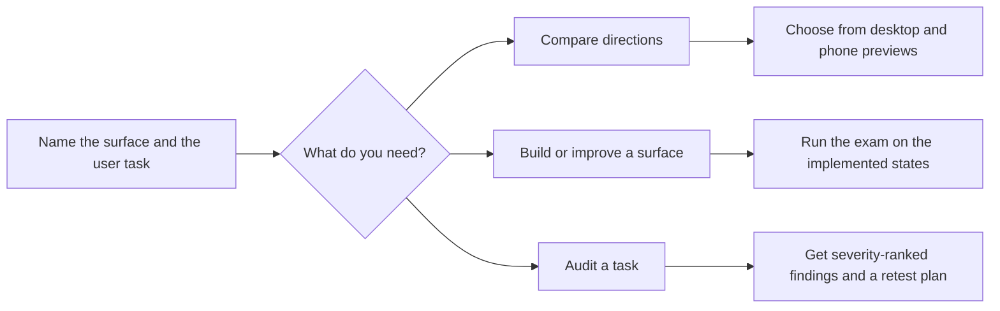
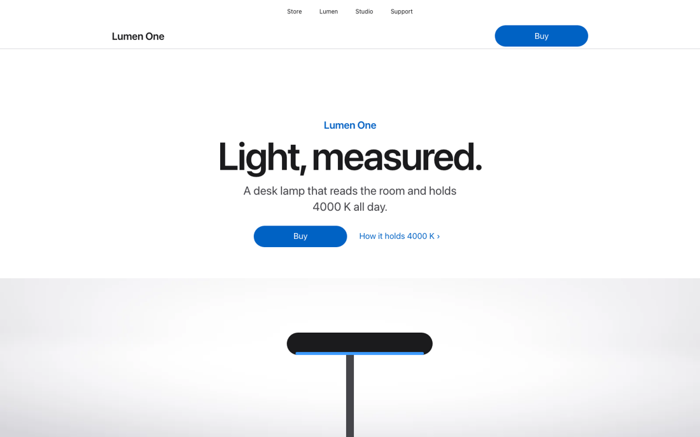
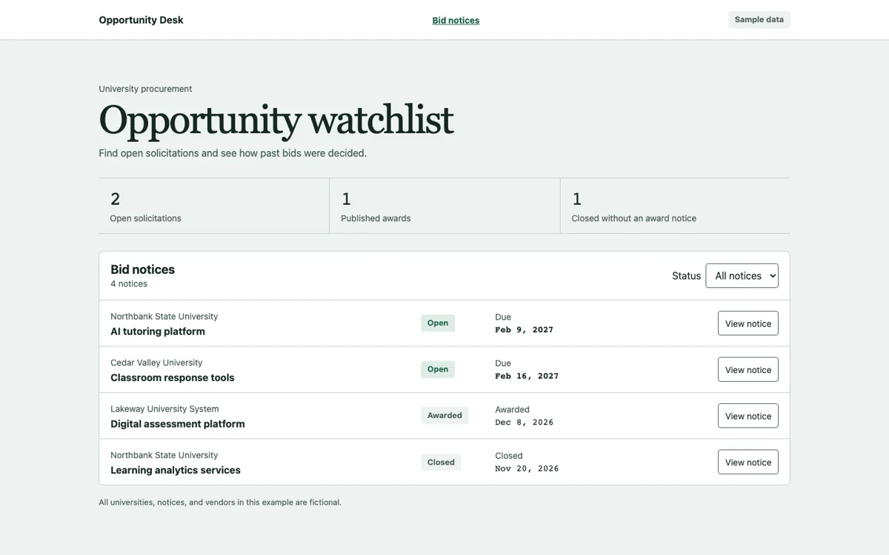
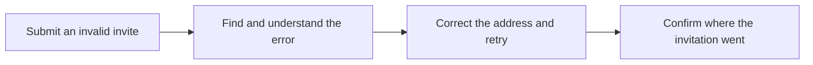

# Fantastic UI by example

In Codex, start with `$fantastic-ui`. In Claude Code, use `/fantastic-ui`.
Describe the surface and the task someone needs to complete. Add the route,
a reference image or `DESIGN.md` if you have one, and say whether you want
options, implementation, or an audit.

## 1. Compare directions for a launch page

> $fantastic-ui Show me two visual directions for a desk lamp launch. The
> visitor should understand the light controls and find the product details.
> Use these product photos and my headline. Show desktop and phone previews
> before implementing. Include your recommendation.

**What you get.** Two comparable previews with the same content and actions,
a short brief for each, and a recommendation. If the direction is already
settled, say “Build in Gallery White” or “Follow our DESIGN.md.”

Try all twelve presets in the [live gallery](https://succtorlin.github.io/fantastic-ui/).
For copyable prompts and screenshots, see the [preset guide](../examples/presets/).

## 2. Build a dashboard with an Astryx layout reference

> $fantastic-ui Build an opportunity watchlist where I can filter open
> university RFPs and inspect past award notices. Use Astryx for layout
> research and implement with our existing components. Show what happens
> when no results match. Label any sample data and run the exam.

**What you get.** The sample adapts Astryx’s `table-filter` pattern into a
bid list with status filters and a detail dialog. Open notices show a deadline.
Awarded and closed notices show their own dates. A closed notice without a
published award stays distinct from an awarded notice. The empty state offers
a clear path back to the list.

[See the phone layout](../assets/opportunity-desk-mobile.webp) · [Run the dashboard locally](../examples/opportunity-desk/) · [Use the Astryx workflow](../skills/fantastic-ui/references/astryx.md)

## 3. Diagnose a confusing form or interaction

> $fantastic-ui Audit `/onboarding/invite` as a first-time team admin. Use
> the keyboard to enter an invalid email, recover, submit a valid invite,
> and confirm what happened. Report evidence and severity before changing code.

**What you get.** Findings tied to what the user sees or hears, with a fix
and a way to verify each one. This sample diagnostic shows three steps in an
invite flow. The findings illustrate what to look for during a real audit.

| Step | Example evidence | Suggested fix and retest |
| --- | --- | --- |
| Understand the error | The invalid field turns red and focus stays on Submit. | Show a text error, associate it with the field, and move focus to it. Retry with the keyboard and a screen reader. |
| Correct and retry | The failed request clears the address. | Preserve the typed address. Correct one character and submit again. |
| Confirm the result | The form closes and the invite list shows no new entry. | Confirm the recipient and display the pending invite. Verify both after submission. |

To request remediation in the same pass, add “Fix confirmed blockers and
retest the same flow.” See the [audit walkthrough](USE-CASES.md#4-accessibility-audit-and-remediation-wcag-22-aa).

## 4. Keep a redesign consistent across an app

> $fantastic-ui Follow our DESIGN.md and apply it to every billing screen,
> including dialogs, drawers, and loading and error states. Inventory the
> routes and shared components first. Work in batches and report what passes.

**What you get.** A route and state inventory, shared token and component
changes, and before/after evidence and exam results for each batch. When
you want one surface, name it and its states explicitly, for example
“Fix only the invoice filter panel, including no results and retry.”

[Read the whole-app walkthrough](USE-CASES.md#3-whole-app-sweep-polish-everything-miss-nothing) · [Install Fantastic UI](../README.md#install)
