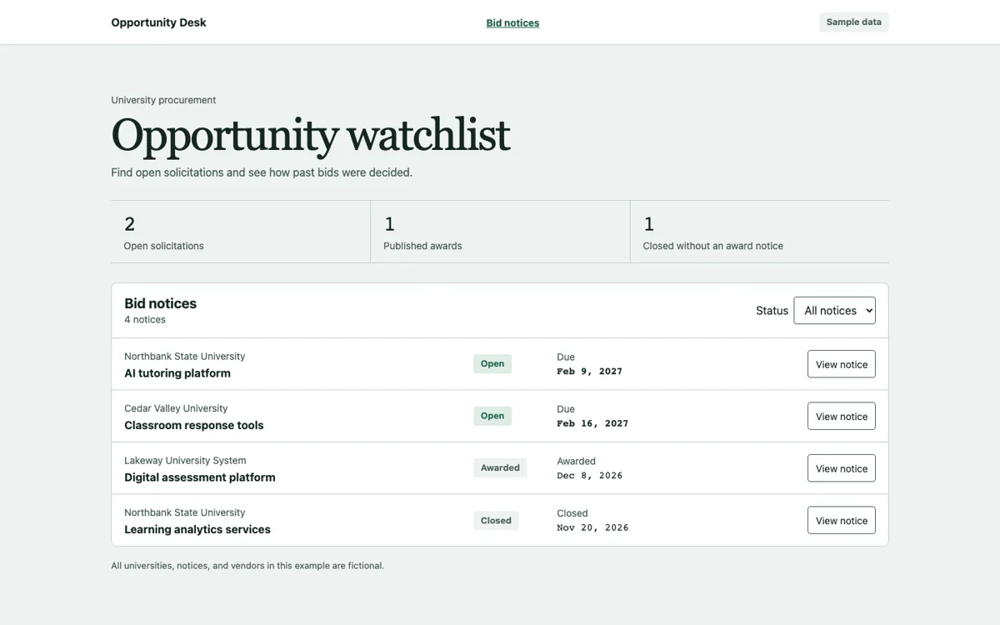

# Opportunity Desk

A runnable Fantastic UI example for browsing university bids. All universities,
vendors, and notices are fictional. The sample uses native HTML, CSS, and
JavaScript and has no runtime dependencies.



From the repository root, serve the example and open
`http://127.0.0.1:8000`.

```bash
python3 -m http.server 8000 --bind 127.0.0.1 --directory examples/opportunity-desk
```

Try **Awarded**, then **View notice**, to see the sample winner and amount.
Press **Escape** to return focus to the button. Choose **Cancelled** to see the
empty state and **Clear filter** to restore all four records.

The brief is a calm procurement workbench with a light green-gray ground,
one evergreen accent, tabular dates, and clear status and deadline
hierarchy. Imagery stays out of the data surface so the records remain easy
to scan.

Astryx was used to research structure. The filter above a list and the
separate detail surface come from inspecting `table-filter`. The demo uses its
own HTML and a native dialog.

```bash
astryx template table-filter --skeleton
node skills/fantastic-ui/scripts/exam.mjs examples/opportunity-desk \
  --lint examples/opportunity-desk --dialog '[data-notice]'
```

The exam needs Playwright and axe. Pass `--modules` if they are installed
outside the repo. The shared notice dialog is exercised through the row
buttons. The example passed the automated exam (1/1), including dialog and
no-JavaScript checks. The award filter, empty state, and focus return were
also exercised in the browser.
