# Fantastic UI preset gallery

All eighteen presets are shown below with a screenshot and a starter
prompt.
The examples use fictional content, except Folio Split, which shows real
captures of one interface. Their illustrations are intentionally
stylized examples of art direction. Use your own product, venue, or team photos
where the prompt calls for them.

Use `$fantastic-ui` in Codex or replace it with `/fantastic-ui` in Claude Code.
For the full design rules, see the [preset reference](../../skills/fantastic-ui/references/theme-presets.md).

**[Open the live gallery](https://succtorlin.github.io/fantastic-ui/).** Every screenshot below opens
its live example. For local development, run this from the repository root
and open [the local gallery](http://127.0.0.1:8000/examples/presets/).

```bash
python3 -m http.server 8000 --bind 127.0.0.1
```

### A · Coastal Editorial

[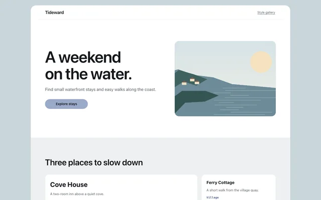](https://succtorlin.github.io/fantastic-ui/examples/presets/coastal-editorial.html)

Airy travel editorial with sea-grey framing, periwinkle and rounded photo slots.

> $fantastic-ui Build a coastal inn directory in Coastal Editorial. Use my waterfront photography and make each stay easy to compare.

[Open live example](https://succtorlin.github.io/fantastic-ui/examples/presets/coastal-editorial.html) · [View source](coastal-editorial.html)

### B · Blueprint Mono

[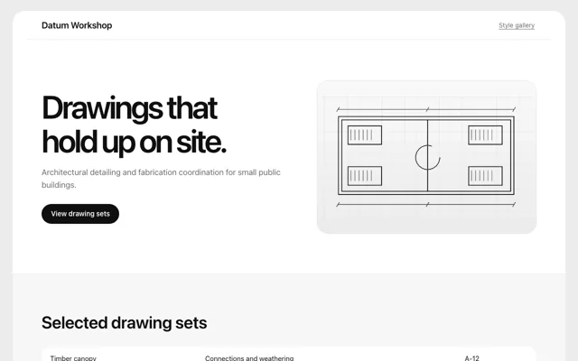](https://succtorlin.github.io/fantastic-ui/examples/presets/blueprint-mono.html)

Monochrome architectural presentation with specimen-like structure and aligned data.

> $fantastic-ui Use Blueprint Mono for a fabrication studio portfolio. Make the drawings and their specifications the focus.

[Open live example](https://succtorlin.github.io/fantastic-ui/examples/presets/blueprint-mono.html) · [View source](blueprint-mono.html)

### C · Marigold Report

[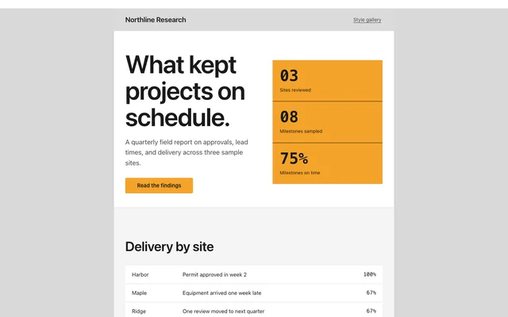](https://succtorlin.github.io/fantastic-ui/examples/presets/marigold-report.html)

Report cover and findings spread with a marigold metric block and print-like rules.

> $fantastic-ui Lay out my quarterly delivery report in Marigold Report. Use gold for section and metric blocks, and keep tables print-friendly.

[Open live example](https://succtorlin.github.io/fantastic-ui/examples/presets/marigold-report.html) · [View source](marigold-report.html) · [Download the A4 report (PDF)](https://succtorlin.github.io/fantastic-ui/examples/presets/marigold-report.pdf)

### D · Atelier Warm

[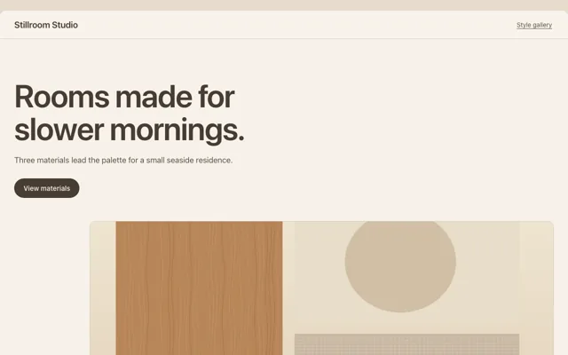](https://succtorlin.github.io/fantastic-ui/examples/presets/atelier-warm.html)

Oat and coffee tones, poster-scale type, and material-led art direction for a studio.

> $fantastic-ui Use Atelier Warm for an interior concept deck. Pair my oak, plaster and linen reference photos with a short note on each material.

[Open live example](https://succtorlin.github.io/fantastic-ui/examples/presets/atelier-warm.html) · [View source](atelier-warm.html)

### E · Terracotta Commerce

[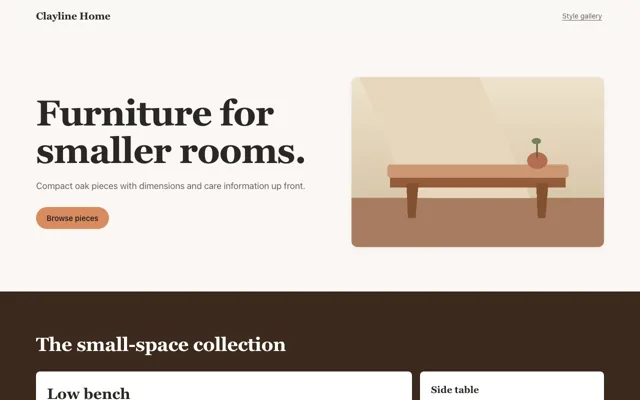](https://succtorlin.github.io/fantastic-ui/examples/presets/terracotta-commerce.html)

Warm retail palette, terracotta actions, lifted product cards and a dark collection band.

> $fantastic-ui Build a compact furniture storefront in Terracotta Commerce. Use my lifestyle photos and show the dimensions beside each product.

[Open live example](https://succtorlin.github.io/fantastic-ui/examples/presets/terracotta-commerce.html) · [View source](terracotta-commerce.html)

### F · Midnight Showroom

[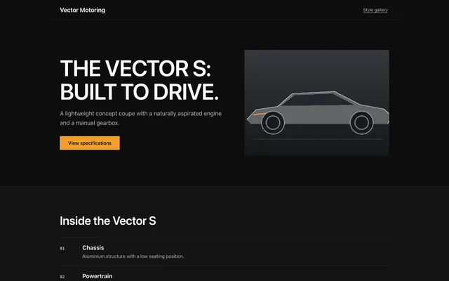](https://succtorlin.github.io/fantastic-ui/examples/presets/midnight-showroom.html)

Luxury showroom with a near-black stage, amber accents and uppercase display type.

> $fantastic-ui Build a car showcase in Midnight Showroom. Stage my cut-out vehicle images on black and keep specifications in a separate section.

[Open live example](https://succtorlin.github.io/fantastic-ui/examples/presets/midnight-showroom.html) · [View source](midnight-showroom.html)

### G · Broadcast Light

[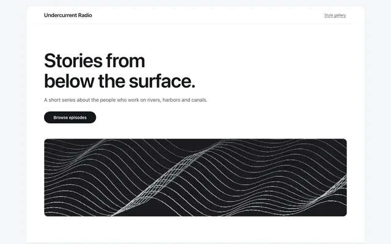](https://succtorlin.github.io/fantastic-ui/examples/presets/broadcast-light.html)

Daylight media index with a black program band, platform links and an episode shelf.

> $fantastic-ui Use Broadcast Light for a podcast hub. Give each episode its own thumbnail, duration, and listening link.

[Open live example](https://succtorlin.github.io/fantastic-ui/examples/presets/broadcast-light.html) · [View source](broadcast-light.html)

### H · Studio Kinetic

[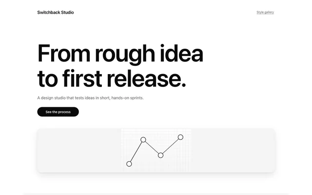](https://succtorlin.github.io/fantastic-ui/examples/presets/studio-kinetic.html)

Monochrome agency page using a grid, pill actions and staggered process cards.

> $fantastic-ui Design our agency process page in Studio Kinetic. Use the team photos I provide and show how a sprint progresses.

[Open live example](https://succtorlin.github.io/fantastic-ui/examples/presets/studio-kinetic.html) · [View source](studio-kinetic.html)

### I · Campus Bright

[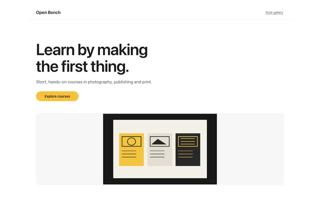](https://succtorlin.github.io/fantastic-ui/examples/presets/campus-bright.html)

High-contrast course catalogue with yellow actions and alternating light and dark bands.

> $fantastic-ui Build a workshop catalogue in Campus Bright. Give every course a thumbnail and make duration and skill level easy to scan.

[Open live example](https://succtorlin.github.io/fantastic-ui/examples/presets/campus-bright.html) · [View source](campus-bright.html)

### J · Charter Navy

[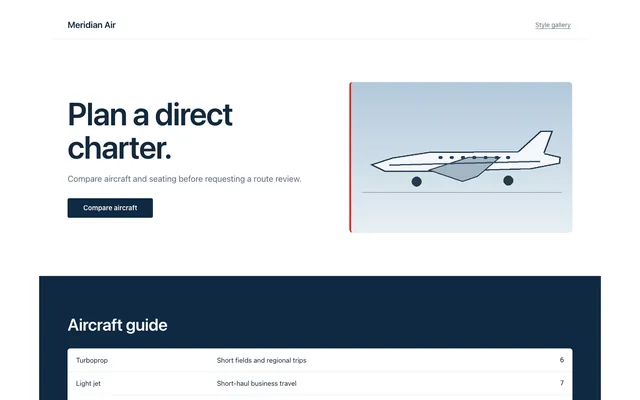](https://succtorlin.github.io/fantastic-ui/examples/presets/charter-navy.html)

Corporate aviation layout with navy framing, white content cards and a restrained red rule.

> $fantastic-ui Design a private charter planner in Charter Navy. Use navy for actions and red only for small marks. Show how seat count differs by aircraft.

[Open live example](https://succtorlin.github.io/fantastic-ui/examples/presets/charter-navy.html) · [View source](charter-navy.html)

### K · Dispatch Yellow

[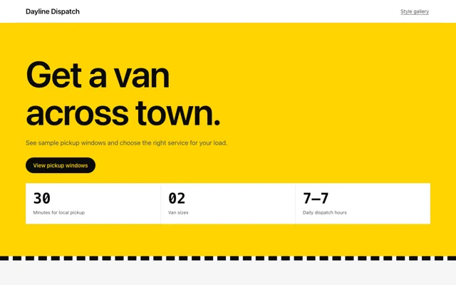](https://succtorlin.github.io/fantastic-ui/examples/presets/dispatch-yellow.html)

Safety-yellow service page with black type, flat panels and a checkered dispatch stripe.

> $fantastic-ui Build a same-day van booking page in Dispatch Yellow. Put pickup windows and load limits before the quote action.

[Open live example](https://succtorlin.github.io/fantastic-ui/examples/presets/dispatch-yellow.html) · [View source](dispatch-yellow.html)

### L · Gallery White

[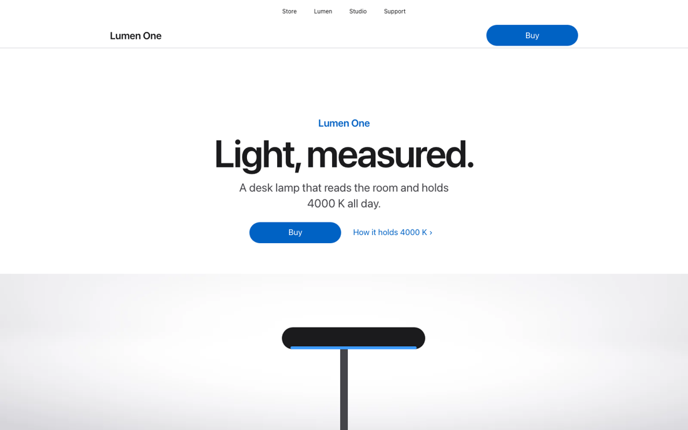](https://succtorlin.github.io/fantastic-ui/examples/gallery-white/index.html)

Quiet studio lighting, generous white space and one blue action.

> $fantastic-ui Build a device launch in Gallery White. Use my product photography and give each section one idea.

[Open live example](https://succtorlin.github.io/fantastic-ui/examples/gallery-white/index.html) · [View source](../gallery-white/index.html)

### M · Folio Split

[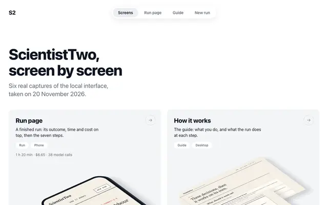](https://succtorlin.github.io/fantastic-ui/examples/folio-split/index.html)

An index of work: equal pale-grey tiles, each with one large, sharp capture running off its edge.

> $fantastic-ui Build a portfolio index in Folio Split. Use my own high-resolution screenshots, one per tile.

[Open live example](https://succtorlin.github.io/fantastic-ui/examples/folio-split/index.html) · [View source](../folio-split/index.html)

### N · Sprint Stage

[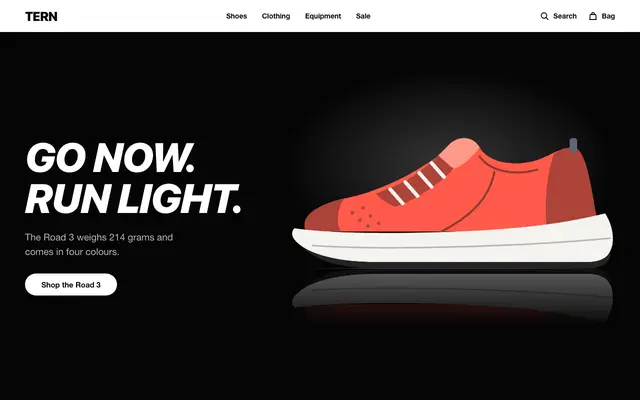](https://succtorlin.github.io/fantastic-ui/examples/sprint-stage/index.html)

A black first screen, a slanted heavy headline and one shoe standing on its reflection.

> $fantastic-ui Build a sportswear shop in Sprint Stage. Use my product photographs and keep the first screen to one product.

[Open live example](https://succtorlin.github.io/fantastic-ui/examples/sprint-stage/index.html) · [View source](../sprint-stage/index.html)

### O · Olive Outfitter

[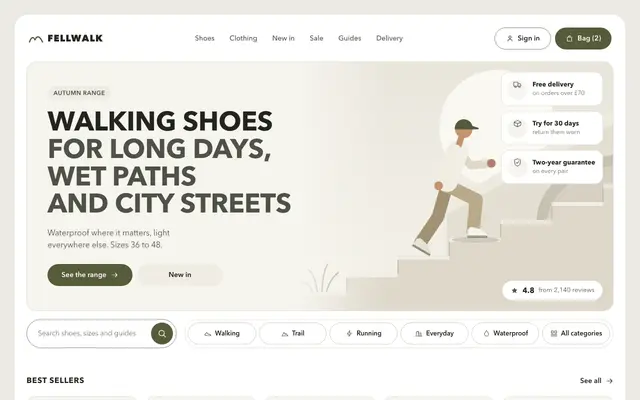](https://succtorlin.github.io/fantastic-ui/examples/olive-outfitter/index.html)

One rounded warm-white sheet, a picture that fades in from the right and dark-olive pill buttons.

> $fantastic-ui Build an outdoor shop in Olive Outfitter. Use my lifestyle photographs and keep every word on a solid surface.

[Open live example](https://succtorlin.github.io/fantastic-ui/examples/olive-outfitter/index.html) · [View source](../olive-outfitter/index.html)

### P · Chamfer Spec

[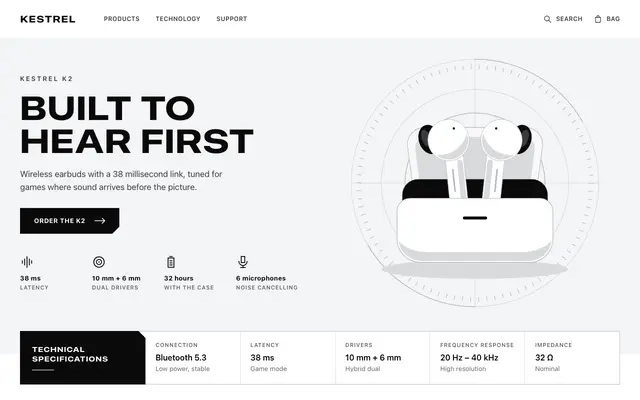](https://succtorlin.github.io/fantastic-ui/examples/chamfer-spec/index.html)

White, silver and black, wide uppercase type, corners cut at 45° and a ruled strip of specifications.

> $fantastic-ui Build a hardware launch page in Chamfer Spec. Give every claim a number with a unit.

[Open live example](https://succtorlin.github.io/fantastic-ui/examples/chamfer-spec/index.html) · [View source](../chamfer-spec/index.html)

### Q · Market Shelf

[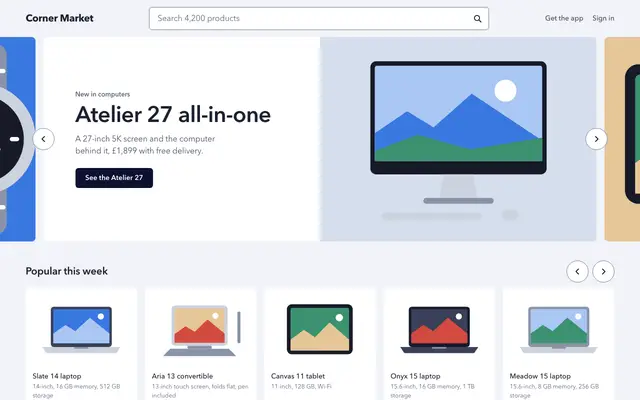](https://succtorlin.github.io/fantastic-ui/examples/market-shelf/index.html)

White product cards on shelves that scroll sideways, with the price as the heaviest text.

> $fantastic-ui Build a marketplace home page in Market Shelf. Use my product photographs and give each category its own shelf.

[Open live example](https://succtorlin.github.io/fantastic-ui/examples/market-shelf/index.html) · [View source](../market-shelf/index.html)

### R · Mono Catalogue

[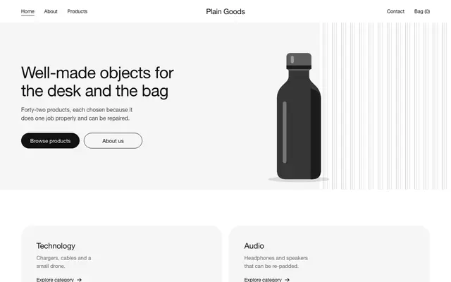](https://succtorlin.github.io/fantastic-ui/examples/mono-catalogue/index.html)

A white page, pale-grey tiles with very large corners and every product in greyscale.

> $fantastic-ui Build a gadget shop in Mono Catalogue. Use my product cut-outs and keep the whole catalogue in greyscale.

[Open live example](https://succtorlin.github.io/fantastic-ui/examples/mono-catalogue/index.html) · [View source](../mono-catalogue/index.html)
## Rebuild the examples

```bash
node examples/presets/build.mjs
node skills/fantastic-ui/scripts/exam.mjs examples/presets
```

The build reads `examples.json` and the skill’s own preset token definitions.
It writes the pages and this guide. The exam uses Playwright and axe-core. If
they are installed elsewhere, pass `--modules /path/to/node_modules`.
The existing [Gallery White example](../gallery-white/) is maintained separately.

Presets M, N, O, P, Q, R are hand-built pages in their own folders beside this one.
The build links to them and does not write them. Preset M shows real
captures of the ScientistTwo interface. On the others, drawings stand in for
product photographs. Examine one with
`node skills/fantastic-ui/scripts/exam.mjs examples/sprint-stage`; their
card pictures in `previews/` are 640×400 screenshots of the first screen.

The **Gallery geometry** check runs on pull requests targeting `main` and
before GitHub Pages deployment. It measures button size and block alignment
in all eighteen packaged examples at 320, 390, and 1440 CSS pixels.
